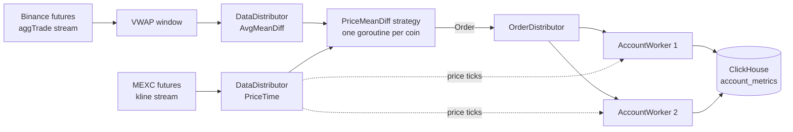

# unicorn-trading-core

[](https://github.com/logovok/unicorn-trading-core/actions/workflows/ci.yml)

A research bot, written in Go, that tests a cross-exchange lead-lag strategy on live market data. It watches Binance futures for short-term price moves, checks whether MEXC futures have followed yet, and paper-trades the gap. Every simulated deal is stored in ClickHouse for analysis.

> **Paper trading only.** The bot reads public market data and never places an order. It needs no exchange API keys. Nothing here is financial advice.

## How it works

Large exchanges tend to move first, and smaller ones follow a moment later. The strategy looks for that moment.

1. **Lead signal (Binance).** For each coin, the bot reads the `aggTrade` stream and keeps a volume-weighted average price (VWAP) over a 15-second sliding window. The signal is the deviation of the latest trade price from that average.
2. **Slow price (MEXC).** The bot reads the latest contract price for the same coin from the MEXC kline stream.
3. **Filters.** A signal becomes an order only if all three hold:
   - the two ticks are at most 400 ms apart,
   - the Binance deviation is at least the coin's `DiffThreshold`,
   - the two exchanges' prices differ by at least the coin's `CrossExchangePriceThreshold`.
4. **Order.** If Binance trades above its average, the bot opens a simulated long on MEXC; if below, a short. The close target is the MEXC price shifted by the Binance deviation.
5. **Simulated deal.** An account worker follows the MEXC price until the deal ends in one of three ways: the target is reached, the price crosses the entry in the wrong direction, or 15 seconds pass. It then books the profit or loss net of commission and stores the deal.

## Architecture



- **Exchange adapters** (`exchanges/`) each own one websocket per coin. They reconnect with exponential backoff (1 s to 30 s) and treat 30 seconds of silence as a dead connection.
- **`DataDistributor[T]`** (`internal/distributors/`) is a generic fan-out: one input channel, any number of subscribers that can join and leave at runtime.
- **Strategy** (`internal/strategies/`) is a pure function from the latest two ticks to an optional order, which keeps it easy to test.
- **`OrderDistributor`** (`internal/orders/`) hands each order to the first idle account worker. If every worker is busy, the order is dropped.
- **Storage** (`internal/storage/`) writes one JSON document per finished deal.

## Project layout

```
main.go                  wiring: exchanges, coins, thresholds, workers
indicatorsEnable.go      starts the data streams for a coin
config/                  ClickHouse settings from environment variables
exchanges/binance/       aggTrade stream and VWAP window
exchanges/mexc/          kline stream
internal/distributors/   generic fan-out DataDistributor[T]
internal/strategies/     PriceMeanDiff strategy
internal/orders/         order dispatch, simulated deals, PnL
internal/storage/        ClickHouse client
internal/types/          shared types and interfaces
```

## Running it

You need Go 1.24 or newer and a ClickHouse server.

**1. Start ClickHouse and create the table.** With Docker:

```sh
docker run -d --name unicorn-ch -p 9000:9000 -e CLICKHOUSE_PASSWORD=test clickhouse/clickhouse-server

docker exec unicorn-ch clickhouse-client --password test -q \
  "CREATE TABLE account_metrics (payload String) ENGINE = MergeTree ORDER BY tuple()"
```

**2. Set the connection settings.** The bot reads them from environment variables. It does not load a `.env` file by itself; `.env.sample` only lists the names.

| Variable | Default | Meaning |
|---|---|---|
| `CLICKHOUSE_URL` | `localhost:9000` | Host and native-protocol port |
| `CLICKHOUSE_USERNAME` | `default` | User |
| `CLICKHOUSE_PASSWORD` | empty | Password |
| `DB_NAME` | `default` | Database |

**3. Run.**

```sh
CLICKHOUSE_PASSWORD=test go run .
```

In PowerShell:

```powershell
$env:CLICKHOUSE_PASSWORD = "test"; go run .
```

The bot logs `Bot started successfully`, then one line per finished deal. If ClickHouse is unreachable, it exits with the reason. Stop it with Ctrl+C.

## Reading the results

Each row of `account_metrics` is one finished deal as JSON: the account, both coins and their thresholds, the indicator values that triggered the order, entry, target and abort prices, open and close times, and the result. For example, deals and total result per account and coin:

```sql
SELECT
    JSONExtractString(payload, 'account_id') AS account,
    JSONExtractString(payload, 'AccountOrder', 'order', 'SlowExchangeCoin', 'coin') AS coin,
    count() AS deals,
    sum(JSONExtractFloat(payload, 'AccountOrder', 'earned')) AS earned
FROM account_metrics
GROUP BY account, coin
```

`earned` is in quote currency (USDT) for the configured order volume, after commission.

## Configuration

Coins, thresholds and strategy parameters are set in `main.go`. The current set is BTC and SHIB, with these knobs:

| Setting | Where | Meaning |
|---|---|---|
| `Window` | coin | Length of the VWAP window (15 s) |
| `DiffThreshold` | lead coin | Minimum Binance deviation from VWAP |
| `CrossExchangePriceThreshold` | slow coin | Minimum price gap between the exchanges |
| `Multiplier` | coin | Converts a quoted price to the price of one coin (Binance quotes SHIB per 1000) |
| `Commission` | slow coin | Fee per deal as a fraction (`0.0002` is 0.02%) |
| `CrossExchangeLag` | threshold set | Maximum age difference between the two ticks (400 ms) |
| `DealTimeout` | threshold set | Maximum deal length (15 s) |
| `OrderVolume` | threshold set | Deal size in USDT (10) |

The parameters are untuned starting values, not a profitable setup.

## Development

```sh
go test ./...
go vet ./...
gofmt -l .
```

CI runs the same checks, with the race detector, on every pull request. Commits follow [Conventional Commits](https://www.conventionalcommits.org/).

## Status and limitations

This is a research project, not a production trading system.

- Deals are simulated at the last seen price, with no order book, slippage or funding.
- Metrics are inserted one row at a time, which is fine for a few deals per minute but not for high volume.
- Coins and parameters are compiled in, not loaded from a config file.

## Authors

- Mykyta Maltsev ([@logovok](https://github.com/logovok))
- Ivan Nyzhnii ([@ivan-coding](https://github.com/ivan-coding))

## License

[MIT](LICENSE)
